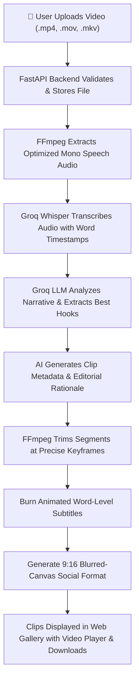

# 🎬 ClipGenerator — AI-Powered Video Clip Generator

> **Transform long-form videos (podcasts, documentaries, educational lectures, interviews) into high-retention viral social clips with word-synchronized subtitles for YouTube Shorts, Instagram Reels, and TikTok.**

100% Free • Open Source • Powered by Python & Groq Cloud AI

---

## 🌟 Highlights & Features

- **⚡ AI Highlight Discovery & Scoring**: Analyzes full transcripts using Groq's high-speed LLM models (`openai/gpt-oss-120b` and Meta LLaMA) to locate narrative hooks, revelations, and viral moments.
- **💡 AI Editorial Rationale ("Why This Moment Was Clipped")**: Every generated clip card includes a detailed breakdown from the AI editor explaining the exact psychological hook, story context, and reasons why this segment was selected.
- **🎙️ Word-Level Accurate Timestamps**: Uses Groq Whisper Cloud (`whisper-large-v3`) for rapid audio-to-text alignment with word-level precision, plus local `faster-whisper` offline fallback.
- **🔥 Social-Ready Animated Captions**: Automatically compiles and burns clean, high-visibility captions (bold text with contrast borders and drop shadows) directly into each video.
- **📱 Dual Aspect Ratio Generation**:
  - **16:9 Landscape**: Ready for YouTube desktop and widescreen players.
  - **9:16 Portrait**: Formatted with modern blurred-background letterboxing for Instagram Reels, YouTube Shorts, and TikTok so speakers and visual graphics are never awkwardly cropped.
- **📺 Web Application Dashboard**:
  - Drag-and-drop video upload with upload progress tracking.
  - Real-time pipeline status tracker (`Queued` → `Transcribing` → `Analyzing` → `Clipping` → `Ready`).
  - Interactive clip player gallery with inline video preview and one-click downloads.
  - Session history tracking.
- **🚀 Zero Mandatory External Services**: Runs out of the box with an in-process Python background thread pool. No Redis or Celery daemons are required, though Celery can be enabled via configuration if desired.

---

## 🛠️ Tech Stack

| Layer | Technology | Description |
|---|---|---|
| **Backend** | `FastAPI` (Python 3.10+) | High-performance async ASGI web framework |
| **Frontend** | HTML5 / Modern CSS / JavaScript | Responsive dark-mode dashboard without node/npm build overhead |
| **LLM Inference** | `Groq API` (`openai/gpt-oss-120b` / `llama-3.3-70b`) | Rapid transcript analysis, hook detection, and clip selection |
| **Speech-to-Text** | `Groq Whisper` (`whisper-large-v3`) | Instant cloud transcription with word-level timestamps |
| **Local Fallback** | `faster-whisper` | Offline CTranslate2-accelerated Whisper transcription |
| **Video Editing** | `FFmpeg` via `imageio-ffmpeg` | Frame-accurate trimming, canvas composition, and subtitle burn |
| **Database** | SQLite via `SQLAlchemy 2.0` (`aiosqlite`) | Async relational persistence for jobs, clips, and metadata |

---

## 📋 System Pipeline



---

## 🚀 Getting Started

### 1. Prerequisites
- Python 3.10, 3.11, 3.12, or 3.13
- A free **Groq API Key** from [console.groq.com](https://console.groq.com)
- FFmpeg (automatically provided on Windows via `imageio-ffmpeg` or installed via system package manager)

### 2. Clone the Repository
```bash
git clone https://github.com/your-username/ClipGenerator.git
cd ClipGenerator
```

### 3. Install Dependencies
```bash
pip install -r requirements.txt
```
*(On Windows, you can also double-click `install.bat`)*

### 4. Configure Environment
Copy the `.env.example` template into `.env`:
```bash
cp .env.example .env
```
Open `.env` and add your Groq API key:
```ini
GROQ_API_KEY=gsk_your_api_key_here
```

### 5. Launch the Web Application
```bash
python run.py
```
*(On Windows, you can also double-click `run.bat`)*

Open your web browser and visit:
```
http://127.0.0.1:8000
```
Interactive API documentation is accessible at `http://127.0.0.1:8000/api/docs`.

---

## ⚙️ Configuration Reference

All settings can be customized in `.env`:

| Variable | Default Value | Description |
|---|---|---|
| `GROQ_API_KEY` | `""` | Your Groq Cloud API key |
| `GROQ_MODEL` | `openai/gpt-oss-120b` | LLM model for transcript analysis and hook extraction |
| `GROQ_WHISPER_MODEL` | `whisper-large-v3` | Groq Whisper model for audio transcription |
| `APP_HOST` | `127.0.0.1` | Local server bind address |
| `APP_PORT` | `8000` | Local server port |
| `USE_CELERY` | `False` | Set `True` to enable Celery + Redis queue |
| `CELERY_BROKER_URL` | `redis://localhost:6379/0` | Celery broker URL |
| `WHISPER_MODEL_SIZE` | `base` | Local Whisper model size (tiny, base, small, medium, large-v3) |
| `FFMPEG_PATH` | `None` | Custom path to FFmpeg binary if not in PATH |

---

## 📁 Repository Structure

```
ClipGenerator/
├── backend/
│   ├── config.py              # Pydantic application configuration
│   ├── database.py            # Async SQLite SQLAlchemy session setup
│   ├── main.py                # FastAPI initialization, routing & static files
│   ├── models.py              # SQLAlchemy 2.0 ORM models (Job, Clip)
│   ├── routes/
│   │   ├── clips.py           # Clip streaming, listing & download routes
│   │   ├── jobs.py            # Job status polling & listing routes
│   │   └── upload.py          # Video upload & worker task dispatcher
│   └── tasks/
│       ├── analyze.py         # AI transcript reasoning & segment selector
│       ├── celery_tasks.py    # Celery task definitions
│       ├── clip.py            # FFmpeg sub-clip cutter & 9:16 portrait generator
│       ├── ffmpeg_utils.py    # Cross-platform FFmpeg locator
│       ├── pipeline_runner.py # Core end-to-end processing pipeline
│       ├── subtitle.py        # Subtitle phrasing, timing & burning
│       └── transcribe.py      # Groq Whisper API & local Whisper fallback
├── frontend/
│   ├── app.js                 # Frontend SPA logic, polling & video rendering
│   ├── index.html             # Responsive dashboard interface
│   └── styles.css             # Modern dark-theme typography and styles
├── outputs/                   # Generated output clips (gitignored)
├── uploads/                   # Uploaded source videos (gitignored)
├── .env.example               # Environment template
├── .gitignore                 # Git ignore rules for data, models & credentials
├── install.bat                # Windows 1-click package installer
├── README.md                  # Project documentation
├── requirements.txt           # Python package requirements
├── run.bat                    # Windows 1-click application launcher
└── run.py                     # Python entry point & environment validator
```

---

## 📖 API Endpoints

- **`POST /api/upload`**: Uploads video file (`multipart/form-data`) and initiates background clip generation. Returns `{ job_id, status, filename }`.
- **`GET /api/jobs/{job_id}`**: Retrieves real-time pipeline status (`queued`, `transcribing`, `analyzing`, `clipping`, `done`, `error`).
- **`GET /api/jobs`**: Lists all recent video jobs.
- **`GET /api/jobs/{job_id}/clips`**: Returns list of all generated clips for a job, including AI titles, editorial reasoning, timestamps, and media links.
- **`GET /api/clips/{clip_id}/stream/portrait`**: Streams 9:16 portrait video for browser playback.
- **`GET /api/clips/{clip_id}/stream/landscape`**: Streams 16:9 landscape video for browser playback.
- **`GET /api/clips/{clip_id}/download/portrait`**: Downloads the 9:16 portrait MP4 file.
- **`GET /api/clips/{clip_id}/download/landscape`**: Downloads the 16:9 landscape MP4 file.

---

## 💡 Best Practices for High-Performing Clips

1. **Clear Audio**: Videos with high audio clarity produce the most accurate word timestamps and hook selections.
2. **Engaging Topics**: Podcasts, interviews, educational explainers, and keynote talks provide rich material for AI hook extraction.
3. **Format Choice**: Use the **9:16 Portrait** version for Instagram Reels, YouTube Shorts, and TikTok, and **16:9 Landscape** for YouTube desktop uploads or presentations.

---

## 🤝 Contributing

Contributions, feedback, and suggestions are welcome!
1. Fork the repository
2. Create a feature branch (`git checkout -b feature/amazing-feature`)
3. Commit your changes (`git commit -m "Add amazing feature"`)
4. Push to the branch (`git push origin feature/amazing-feature`)
5. Open a Pull Request

---

## 📄 License

This project is licensed under the terms of the MIT License.
